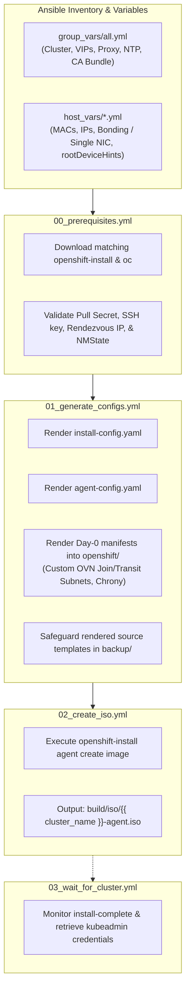

# Production-Grade OpenShift Agent-Based Installer (ABI) Ansible Automation

[](https://docs.openshift.com)
[](https://docs.ansible.com)
[](LICENSE)

Production-grade Ansible automation to generate customizable, self-contained bootable ISOs (`agent.iso`) using the **Red Hat OpenShift Agent-Based Installer (ABI)** for physical bare-metal nodes.

---

## Table of Contents
- [Architecture Overview](#architecture-overview)
- [Key Features](#key-features)
- [Directory Layout](#directory-layout)
- [Prerequisites](#prerequisites)
- [Configuration Guide](#configuration-guide)
  - [1. Automated Tool Download](#1-automated-tool-download)
  - [2. Platform & Virtual IPs (VIPs)](#2-platform--virtual-ips-vips)
  - [3. Network Modes: Bonding vs Single NIC](#3-network-modes-bonding-vs-single-nic)
  - [4. Custom Day-0 Network Operator (OVN-Kubernetes)](#4-custom-day-0-network-operator-ovn-kubernetes)
  - [5. Enterprise Proxy & Trusted CA Bundle](#5-enterprise-proxy--trusted-ca-bundle)
  - [6. Time Synchronization (NTP / Chrony)](#6-time-synchronization-ntp--chrony)
  - [7. Disk Targeting (rootDeviceHints)](#7-disk-targeting-rootdevicehints)
- [Execution Workflow](#execution-workflow)
- [Post-Generation & Node Booting](#post-generation--node-booting)

---

## Architecture Overview



---

## Key Features

* **Strict Red Hat Compliance**: 100% compliant with Red Hat OpenShift Container Platform Agent-Based Installation documentation and schemas (`apiVersion: v1beta1` for `AgentConfig`).
* **Automated Binary Lifecycle**: Automatically downloads the exact matching version of `openshift-install`, `oc`, and `kubectl` directly from official Red Hat mirrors (`mirror.openshift.com`) with OS and architecture autodetection.
* **Production Networking (NMState)**:
  * **Network Bonding**: LACP `802.3ad` (Mode 4), `active-backup` (Mode 1), `balance-xor` (Mode 2) with customizable `miimon` and `lacp_rate`.
  * **Single NIC**: Non-bonded setups with static IP, netmask, gateway, and DNS servers.
* **Custom Day-0 Network Operator**: Automatically injects custom `Network.operator.openshift.io/v1` manifests into `<install_dir>/openshift/` to support customized cluster CIDRs, host prefixes, `internalJoinSubnet`, and `internalTransitSwitchSubnet`.
* **Enterprise Security & Governance**:
  * Injects enterprise Root CA certs (`additionalTrustBundle`) for SSL inspection proxies and private container registries.
  * Enterprise Egress Proxy (`httpProxy`, `httpsProxy`, `noProxy`) with automatic derivation of internal cluster CIDRs and domains.
  * FIPS mode toggle (`fips: true | false`).
* **Time Synchronization**: Configures NTP via `additionalNTPSources` in `agent-config.yaml` and deploys Day-0 Chrony `MachineConfig` to guarantee clock sync during etcd bootstrapping.
* **Deterministic Disk Selection**: Employs `rootDeviceHints` (`deviceName`, `wwn`, `serialNumber`, `rotational`) to ensure CoreOS installs onto the correct drive without touching SAN/multipath data LUNs.
* **Safe State & Template Preservation**: Preserves source configurations in `build/rendered_configs/` to protect against the installer's native behavior of deleting `install-config.yaml` and `agent-config.yaml` during ISO generation.

---

## Directory Layout

```text
openshift-ABI-ansible/
├── ansible.cfg                          # Optimal Ansible engine configuration
├── requirements.yml                     # Required Ansible collections
├── pull-secret.txt.example              # Sample pull secret file
├── inventory/
│   ├── hosts.yml                        # Node inventory (bastion, masters, workers)
│   ├── group_vars/
│   │   ├── all.yml                      # Global cluster configuration
│   │   ├── masters.yml                  # Control plane sizing & roles
│   │   └── workers.yml                  # Worker node sizing & roles
│   └── host_vars/
│       ├── master-01.example.com.yml    # Rendezvous node (Bonded 802.3ad LACP)
│       ├── master-02.example.com.yml    # Master 02 (Bonded active-backup)
│       ├── master-03.example.com.yml    # Master 03 (Bonded active-backup)
│       ├── worker-01.example.com.yml    # Worker 01 (Bonded 802.3ad LACP)
│       └── worker-02.example.com.yml    # Worker 02 (Non-bonded Single NIC)
├── roles/
│   ├── abi_prereqs/                     # Tool download & pre-flight assertions
│   ├── abi_config/                      # Jinja2 rendering of install-config, agent-config, day-0
│   ├── abi_build_iso/                   # Safe staging & openshift-install execution
│   └── abi_monitor/                     # Installation completion monitoring & cred extraction
├── playbooks/
│   ├── 00_prerequisites.yml
│   ├── 01_generate_configs.yml
│   ├── 02_create_iso.yml
│   └── 03_wait_for_cluster.yml
├── site.yml                             # End-to-end master playbook
└── README.md
```

---

## Prerequisites

1. **Ansible Bastion Host**: A machine (RHEL 8/9, Fedora, or macOS/Linux) with:
   * Python 3.9+
   * Ansible Core $\ge$ 2.14
2. **Red Hat Pull Secret**: Download from [console.redhat.com](https://console.redhat.com/openshift/install/pull-secret) and save to `pull-secret.txt`.
3. **SSH Key Pair**: Standard SSH public key (e.g. `~/.ssh/id_rsa.pub`).
4. **Network & DNS Planning**:
   * Pre-allocated static IPs for all nodes, `apiVIP`, and `ingressVIP`.
   * DNS records:
     * `api.<cluster_name>.<base_domain>` $\rightarrow$ `api_vip`
     * `api-int.<cluster_name>.<base_domain>` $\rightarrow$ `api_vip`
     * `*.apps.<cluster_name>.<base_domain>` $\rightarrow$ `ingress_vip`

---

## Configuration Guide

### 1. Automated Tool Download
In `inventory/group_vars/all.yml`:
```yaml
ocp_version: "4.16.14"               # Specify target OpenShift version
download_binaries: true             # Automatically fetch openshift-install & oc
bin_dir: "{{ playbook_dir }}/bin"   # Local directory where binaries are saved
```

### 2. Platform & Virtual IPs (VIPs)
For bare-metal clusters with Keepalived-managed VIPs:
```yaml
platform_type: "baremetal"
api_vips:
  - "192.168.10.5"
ingress_vips:
  - "192.168.10.6"
rendezvous_ip: "192.168.10.11"      # Must match master-01 IP
```
*(If using an external hardware load balancer like F5 or HAProxy, set `platform_type: "none"`).*

### 3. Network Modes: Bonding vs Single NIC

#### Option A: Network Bonding (`inventory/host_vars/master-01.example.com.yml`)
```yaml
network_mode: "bond"
bond_config:
  name: "bond0"
  mode: "802.3ad"                   # or "active-backup", "balance-xor"
  options:
    miimon: "100"
    lacp_rate: "fast"
  interfaces:
    - name: "enp1s0"
      mac: "52:54:00:10:01:01"
    - name: "enp2s0"
      mac: "52:54:00:10:01:02"
  ip: "192.168.10.11"
  prefix_length: 24
  gateway: "192.168.10.1"
  dns_servers:
    - "192.168.10.1"
```

#### Option B: Non-Bonded Single NIC (`inventory/host_vars/worker-02.example.com.yml`)
```yaml
network_mode: "single_nic"
nic_config:
  name: "eno1"
  mac: "52:54:00:20:02:01"
  ip: "192.168.10.22"
  prefix_length: 24
  gateway: "192.168.10.1"
  dns_servers:
    - "192.168.10.1"
```

### 4. Custom Day-0 Manifests (`manifests/` Folder)
All Day-0 custom configurations (such as the custom Network Operator CR, custom MachineConfigs, or storage operators) are managed directly by placing your YAML manifests into the project's `manifests/` folder:

```text
manifests/
└── 01-cluster-network.yaml    # Pre-configured with custom join/transit subnets
```

Any `*.yaml` or `*.yml` file placed inside `manifests/` is automatically discovered, copied into `<install_dir>/openshift/`, and baked into the bootable ISO. No extra variables needed.

The included `manifests/01-cluster-network.yaml` is pre-populated with:
```yaml
apiVersion: operator.openshift.io/v1
kind: Network
metadata:
  name: cluster
spec:
  clusterNetwork:
  - cidr: 100.96.0.0/14
    hostPrefix: 21
  externalIP:
    policy: {}
  networkType: OVNKubernetes
  serviceNetwork:
  - 100.100.0.0/16
  defaultNetwork:
    type: OVNKubernetes
    ovnKubernetesConfig:
      ipv4:
        internalJoinSubnet: 100.101.0.0/16
        internalTransitSwitchSubnet: 100.102.0.0/16
status: {}
```

### 5. Enterprise Proxy & Trusted CA Bundle
If `proxy_enabled` is set to `false` or `http_proxy` is empty, the `proxy` block is **completely omitted** from `install-config.yaml`.

When enabled, the installer automatically compiles all mandatory OpenShift `noProxy` defaults:
```
.cluster.local, 127.0.0.1, localhost, .<base_domain>, <base_domain>, .<cluster_fqdn>, <cluster_fqdn>, <cluster_cidr>, <service_cidr>, <machine_cidr>, <rendezvous_ip>, <api_vips>, <ingress_vips>
```
To append custom enterprise domains:
```yaml
proxy_enabled: true
http_proxy: "http://proxy.corp.example.com:8080"
https_proxy: "http://proxy.corp.example.com:8080"
custom_no_proxy:
  - "corp.example.com"
  - "internal.registry.example.com"
```

For enterprise Root CA certificates, you can specify either a **file path** or a raw PEM string:
```yaml
# Specify path to your enterprise root CA certificate (or leave empty to omit)
additional_trust_bundle_file: "{{ abi_project_root }}/manifests/ca-bundle.pem"
```
If neither `additional_trust_bundle_file` nor `additional_trust_bundle_raw` is specified, `additionalTrustBundle` is **completely omitted** from `install-config.yaml`.

### 6. Dynamic Parameter Omission
In production, you often want only the parameters you explicitly configured. The templates dynamically omit unmentioned parameters:
* `machineNetwork`: If `machine_network_cidr` is empty or commented out, `machineNetwork` is omitted.
* `additionalTrustBundle`: If no CA cert file or string is provided, `additionalTrustBundle` is omitted.
* `proxy`: If `proxy_enabled: false` or `http_proxy` is empty, `proxy` is omitted.
* `additionalNTPSources`: If `additional_ntp_sources` is empty or omitted, `additionalNTPSources` is omitted from `agent-config.yaml`.
* `rootDeviceHints`: If a host in `host_vars` does not specify `root_device_hints`, it is omitted for that host.

### 6. Time Synchronization (NTP / Chrony)
```yaml
additional_ntp_sources:
  - "192.168.10.1"
  - "time.corp.example.com"
chrony_machineconfig_enabled: true
```

### 7. Disk Targeting (rootDeviceHints)
Inside each node's `host_vars`:
```yaml
root_device_hints:
  deviceName: "/dev/sda"            # or "/dev/nvme0n1"
  # serialNumber: "WD-WCC4N0123456"
  # rotational: false
```

---

## Execution Workflow

### 1. Install Collection Dependencies
```bash
ansible-galaxy collection install -r requirements.yml
```

### 2. Configure Credentials
Place your Red Hat pull secret in `pull-secret.txt`:
```bash
cp pull-secret.txt.example pull-secret.txt
# Paste valid JSON pull secret from console.redhat.com
```

### 3. Run the End-to-End Pipeline
```bash
ansible-playbook site.yml
```

### Or Run Phases Individually:

* **Phase 0: Download Binaries & Run Pre-Flight Assertions**
  ```bash
  ansible-playbook playbooks/00_prerequisites.yml
  ```
* **Phase 1: Render Configurations & Day-0 Manifests**
  ```bash
  ansible-playbook playbooks/01_generate_configs.yml
  ```
* **Phase 2: Build the Bootable ISO**
  ```bash
  ansible-playbook playbooks/02_create_iso.yml
  ```

---

## Post-Generation & Node Booting

Once generation completes, the ISO is located at:
```text
build/iso/<cluster_name>-agent.iso
```

### Boot Sequence:
1. Mount the ISO as virtual media (via BMC / iDRAC / iLO / Redfish or flash onto a bootable USB).
2. **Boot the Rendezvous Node (`192.168.10.11`) FIRST** (or simultaneously with the other nodes).
3. The Rendezvous node starts the Assisted Discovery Agent and embedded Assisted Service.
4. Other master and worker nodes check in automatically using their static NMState IP/Bonding definitions.
5. Installation initiates autonomously once all declared hosts are discovered and validated.

### Monitor Installation Progress:
```bash
ansible-playbook playbooks/03_wait_for_cluster.yml
```
Or directly using the CLI:
```bash
./bin/openshift-install agent wait-for install-complete --dir build/installer_dir --log-level=info
```
Upon completion, cluster credentials and kubeconfig are reported:
```bash
export KUBECONFIG=build/installer_dir/auth/kubeconfig
./bin/oc get nodes
```
