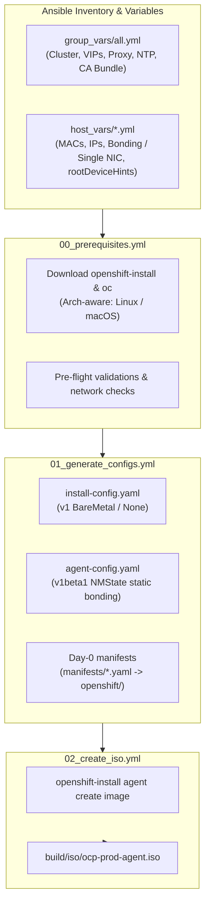

# Production-Grade OpenShift Agent-Based Installer (ABI) Ansible Automation

[](https://docs.openshift.com)
[](https://docs.ansible.com)
[](LICENSE)

Production-grade Ansible automation to generate customizable, self-contained bootable ISOs (`agent.iso`) using the **Red Hat OpenShift Agent-Based Installer (ABI)** for physical bare-metal nodes.

---

## Table of Contents
- [Architecture Overview](#architecture-overview)
- [Key Features](#key-features)
- [Directory Layout](#directory-layout)
- [Prerequisites](#prerequisites)
- [Configuration Guide](#configuration-guide)
  - [1. Automated Tool Download](#1-automated-tool-download)
  - [2. Platform & Virtual IPs (VIPs)](#2-platform--virtual-ips-vips)
  - [3. Network Modes: Bonding vs Single NIC](#3-network-modes-bonding-vs-single-nic)
  - [4. Custom Day-0 Network Operator (OVN-Kubernetes)](#4-custom-day-0-network-operator-ovn-kubernetes)
  - [5. Enterprise Proxy & Trusted CA Bundle](#5-enterprise-proxy--trusted-ca-bundle)
  - [6. Time Synchronization (NTP / Chrony)](#6-time-synchronization-ntp--chrony)
  - [7. Disk Targeting (rootDeviceHints)](#7-disk-targeting-rootdevicehints)
- [Execution Workflow](#execution-workflow)
- [Post-Generation & Node Booting](#post-generation--node-booting)

---

## Architecture Overview



---

## Key Features

1. **Automated Binary Lifecycle**:
   - Dynamically identifies host operating system (`Darwin` vs `Linux`) and architecture (`arm64` vs `x86_64` / `amd64`).
   - Downloads, extracts, and validates matching versions of `openshift-install` and `oc` from Red Hat mirrors.
   - Built-in resilient download mechanism with automatic fallback to system `curl` and POSIX `tar`.

2. **Network Flexibility (NMState Bonding & Non-Bonding)**:
   - **LACP (802.3ad)** bonding with configurable `fast` / `slow` LACP rate and miimon timers.
   - **Active-Backup** bonding for active/standby interfaces.
   - **Balance-XOR** for switch-assisted hash-based load balancing.
   - **Single NIC** non-bonded interface configurations.

3. **Custom Day-0 Manifest Ingestion**:
   - Any Kubernetes/OpenShift YAML manifest placed into `manifests/` (e.g. `01-cluster-network.yaml`) is automatically injected into `<install_dir>/openshift/`.
   - Out-of-the-box support for custom OVN-Kubernetes internal subnets (`internalJoinSubnet`, `internalTransitSwitchSubnet`).

4. **Enterprise Proxy & CA Bundle**:
   - Configurable HTTP/HTTPS proxy with **mandatory defaults** automatically injected (`.cluster.local`, `127.0.0.1`, `localhost`, `.baseDomain`, and `machineNetwork CIDR`).
   - Custom CA certificate injection via `additionalTrustBundle`.
   - **Clean YAML generation**: Omits proxy, trust bundle, or machineNetwork sections entirely when not defined.

5. **Bare-Metal Disk Pinning (`rootDeviceHints`)**:
   - Targets specific physical or NVMe drives (e.g., `deviceName: "/dev/sda"`, `hctl`, `wwn`, `serialNumber`, `rotational: false`).
   - Prevents installer ambiguity across heterogeneous hardware platforms.

6. **Time Synchronization (NTP)**:
   - Upstream Chrony / NTP server injection directly into `agent-config.yaml` host rendezvous declarations.

---

## Directory Layout

```text
openshift-ABI-ansible/
├── ansible.cfg                          # Optimized Ansible configuration
├── requirements.yml                     # Ansible Galaxy collection dependencies
├── site.yml                             # Master orchestration playbook
├── playbooks/
│   ├── 00_prerequisites.yml            # Binary downloads and input sanity
│   ├── 01_generate_configs.yml         # Template rendering & manifest staging
│   ├── 02_create_iso.yml               # ABI image creation command
│   └── 03_wait_for_cluster.yml         # Post-boot installation monitor
├── manifests/
│   └── 01-cluster-network.yaml         # Day-0 custom OVN join & transit subnets
├── inventory/
│   ├── hosts.yml                        # 3 Masters, 2 Workers, 1 Bastion
│   ├── group_vars/
│   │   ├── all.yml                      # Global VIPs, Proxy, NTP, Mirror config
│   │   ├── masters.yml                  # Master node definitions
│   │   └── workers.yml                  # Worker node definitions
│   └── host_vars/
│       ├── master-01.example.com.yml    # Rendezvous node (LACP bond)
│       ├── master-02.example.com.yml    # Control plane 2 (LACP bond)
│       ├── master-03.example.com.yml    # Control plane 3 (LACP bond)
│       ├── worker-01.example.com.yml    # Worker 1 (Active-Backup bond)
│       └── worker-02.example.com.yml    # Worker 2 (Single NIC)
└── roles/
    ├── abi_prereqs/                     # Download & pre-flight assertions
    ├── abi_config/                      # Jinja2 templating & manifest copy
    ├── abi_build_iso/                   # openshift-install agent create image
    └── abi_monitor/                     # Installation completion watcher
```

---

## Configuration Guide

### 1. Automated Tool Download
In `inventory/group_vars/all.yml`:
```yaml
ocp_version: "4.22.22"       # Or "4.16.14", "4.15.28", "latest"
download_binaries: true      # Automatically pulls oc and openshift-install
```
If you are air-gapped, set `download_binaries: false` and place pre-downloaded binaries into `bin/`.

### 2. Virtual IPs (VIPs) & Base Domain
```yaml
cluster_name: "ocp-prod"
base_domain: "example.com"
api_vip: "192.168.10.5"
ingress_vip: "192.168.10.6"
machine_network_cidr: "192.168.10.0/24"
```

### 3. Network Modes: Bonding vs Single NIC

#### A. 802.3ad LACP Bonding (`master-01.example.com.yml`):
```yaml
network_mode: "bond"
bond_name: "bond0"
bond_mode: "802.3ad"
bond_lacp_rate: "fast"
bond_miimon: 100
bond_interfaces:
  - name: "eno1"
    mac_address: "52:54:00:aa:01:01"
  - name: "eno2"
    mac_address: "52:54:00:aa:01:02"
ip_address: "192.168.10.11"
prefix_length: 24
gateway: "192.168.10.1"
dns_servers:
  - "192.168.10.1"
```

#### B. Active-Backup Bonding (`worker-01.example.com.yml`):
```yaml
network_mode: "bond"
bond_name: "bond0"
bond_mode: "active-backup"
bond_interfaces:
  - name: "ens1f0"
    mac_address: "52:54:00:bb:01:01"
  - name: "ens1f1"
    mac_address: "52:54:00:bb:01:02"
ip_address: "192.168.10.21"
```

#### C. Single NIC Non-Bonding (`worker-02.example.com.yml`):
```yaml
network_mode: "single_nic"
interface_name: "eno1"
mac_address: "52:54:00:bb:01:03"
ip_address: "192.168.10.22"
```

### 4. Custom Day-0 Network Operator (OVN-Kubernetes)
Custom OVN subnets are placed in `manifests/01-cluster-network.yaml`:
```yaml
apiVersion: operator.openshift.io/v1
kind: Network
metadata:
  name: cluster
spec:
  clusterNetwork:
  - cidr: 100.96.0.0/14
    hostPrefix: 21
  networkType: OVNKubernetes
  serviceNetwork:
  - 100.100.0.0/16
  defaultNetwork:
    type: OVNKubernetes
    ovnKubernetesConfig:
      ipv4:
        internalJoinSubnet: 100.101.0.0/16
        internalTransitSwitchSubnet: 100.102.0.0/16
```
Any additional `.yaml` files placed in `manifests/` will automatically be copied to `<install_dir>/openshift/`.

### 5. Enterprise Proxy & Trusted CA Bundle
In `inventory/group_vars/all.yml`:
```yaml
proxy_enabled: true
http_proxy: "http://proxy.example.com:8080"
https_proxy: "http://proxy.example.com:8080"
user_no_proxy_domains:
  - ".internal.example.com"

# Path to PEM bundle:
additional_trust_bundle_file: "/etc/pki/ca-trust/source/anchors/corp-root-ca.pem"
```

### 6. Time Synchronization (NTP)
```yaml
ntp_servers:
  - "192.168.10.1"
  - "time.cloudflare.com"
```

### 7. Disk Targeting (rootDeviceHints)
```yaml
rootDeviceHints:
  deviceName: "/dev/sda"
```

---

## Execution Workflow

### 1. Install Galaxy Requirements
```bash
ansible-galaxy collection install -r requirements.yml
```

### 2. Configure Credentials
Place your Red Hat pull secret in `pull-secret.txt`:
```bash
cp pull-secret.txt.example pull-secret.txt
# Paste valid JSON pull secret from console.redhat.com
```

### 3. Run the End-to-End Pipeline
```bash
ansible-playbook site.yml
```

### Or Run Phases Individually:

* **Phase 0: Download Binaries & Run Pre-Flight Assertions**
  ```bash
  ansible-playbook playbooks/00_prerequisites.yml
  ```
* **Phase 1: Render Configurations & Day-0 Manifests**
  ```bash
  ansible-playbook playbooks/01_generate_configs.yml
  ```
* **Phase 2: Build the Bootable ISO**
  ```bash
  ansible-playbook playbooks/02_create_iso.yml
  ```

---

## Post-Generation & Node Booting

Once generation completes, the ISO is located at:
```text
build/iso/<cluster_name>-agent.iso
```

### Boot Sequence:
1. Mount the ISO as virtual media (via BMC / iDRAC / iLO / Redfish or flash onto a bootable USB).
2. **Boot the Rendezvous Node (`192.168.10.11`) FIRST** (or simultaneously with the other nodes).
3. The Rendezvous node starts the Assisted Discovery Agent and embedded Assisted Service.
4. Other master and worker nodes check in automatically using their static NMState IP/Bonding definitions.
5. Installation initiates autonomously once all declared hosts are discovered and validated.

### Monitor Installation Progress:
```bash
ansible-playbook playbooks/03_wait_for_cluster.yml
```
Or directly using the CLI:
```bash
./bin/openshift-install agent wait-for install-complete --dir build/installer_dir --log-level=info
```
Upon completion, cluster credentials and kubeconfig are reported:
```bash
export KUBECONFIG=build/installer_dir/auth/kubeconfig
./bin/oc get nodes
```
